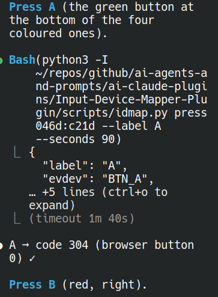
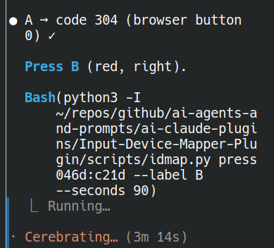

# Input Device Mapper

Identify an input device on Linux and map its physical buttons to what the system actually receives. Plug in a
gamepad, macro pad, foot pedal or presentation remote; the agent finds it (vendor:product, driver, stable
`/dev/input/by-id` path), asks you to press one button at a time and confirms each as you go, and writes a device
profile: physical label → evdev code → predicted browser gamepad index.

## What a session looks like

The agent names one button, waits for the press, confirms what it sent, then names the next:

<p>


</p>

Use it before building per-device bindings in an app, an input-remapper preset or a shortcut.

## Skills

- `map-input-device`: find the device, read its declared keys/axes, run the guided press session, check the
  browser's Gamepad API view, record the profile.

## Script

`scripts/idmap.py` (python3 + `python3-evdev`), JSON output:

| Command | Does |
|---|---|
| `list` | every evdev node with vendor:product, bus, driver, class, stable paths |
| `info <dev>` | udev properties, declared keys, axes and ranges, force feedback |
| `capture <dev> --count N` | the first N distinct inputs, in press order (keys, hat directions, axes past half travel) |
| `press <dev> --label L` | wait for one input and print it (the guided session) |
| `watch <dev> --seconds S` | every press as JSON lines |

`<dev>` is `/dev/input/eventN`, a `/dev/input/by-id/...` path, or `vvvv:pppp`.

Needs read access to `/dev/input/event*`: be in the `input` group (`sudo usermod -aG input $USER`, then log in again).

## Relation to hotkey-builder

`hotkey-builder` finds free **keyboard** keys and binds shortcuts. This plugin is device-first: what is this thing,
and what does each of its buttons send, including gamepads and analog triggers.

## Installation

```bash
claude plugins install input-device-mapper@danielrosehill
```

## License

MIT
